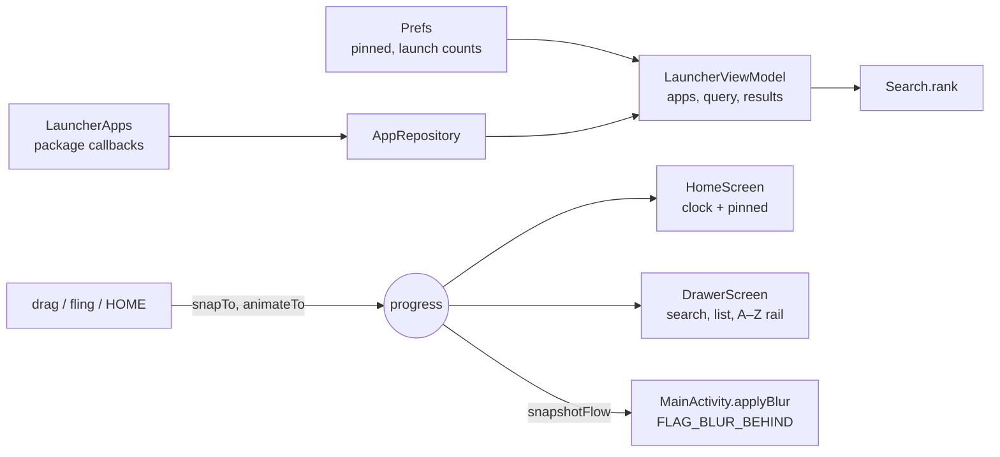

# Quiete

A typographic Android launcher. Kotlin, Jetpack Compose, no dependencies beyond
AndroidX.

No icon grid. No widgets. No pages. The home screen is a clock and a short list of
names, bottom-left, over an untouched wallpaper. Everything else lives one upward
drag away.

---

## The argument

Stock Android home screens are *dense by default*: a grid of saturated icons,
badges, a search pill, a dock, a page indicator. Every one of those elements is
competing for the same attention, and none of them is the thing you actually came
to do — which is open one app.

Quiete inverts the default. The screen is mostly empty. What remains is set in
type, aligned to a single left gutter, and placed where the thumb already is.

Three rules produce almost all of the look:

**1. Text before icons.** A word is faster to recognise than a 48dp pictogram once
you know the app, and an alphabetical list of words scales to 400 apps where a grid
does not. Icons appear nowhere in the interface.

**2. Bounded surfaces, lit from above.** Everything lives in a panel with a
continuous-curvature corner and a hairline ring that runs bright at the top and
almost black at the bottom. That gradient is not decoration — it is what an edge
does under a light source, and it is most of the difference between "a card" and
"an object". See `ui/effect/Panel.kt` and `ui/theme/Squircle.kt`.

**3. Density, earned by rhythm.** 13–17sp for nearly everything; hierarchy comes
from weight, colour and position rather than from size. Size is the crudest lever
and costs the most space. What reads as cluttered is *irregular* spacing, not close
spacing — so the grid is six steps and nothing else. See `ui/theme/Type.kt`.

> **An earlier version of this document argued the exact opposite of rule 2** — no
> cards, no containers, one 86sp hairline clock against 12sp uppercase captions.
> It was internally consistent and it looked like a poster, not a tool. Recorded
> here because the reversal is the most useful thing in the file: austerity is not
> the same as craft, and an empty screen reads as unfinished rather than as calm.

## Architecture

The whole launcher is built around one number: `progress` ∈ [0, 1], an
`Animatable<Float>` owned by `LauncherRoot`. Home and drawer both *read* it; only
gestures and springs *write* it. The Activity subscribes to it to drive the
platform wallpaper blur.



```
data/          AppRepository (LauncherApps), fuzzy Search, Prefs
ui/theme/      Tokens.kt — colour, space, motion.  Type.kt — the whole voice.  Squircle.kt
ui/effect/     Panel (lit hairline ring), Glass, Grain
ui/home/       Clock, HomeScreen
ui/drawer/     DrawerScreen, Scrubber, SearchField
ui/            AppRow, ActionSheet, LauncherRoot (owns `progress`)
```

Swapping `private val Face` in `Type.kt` changes the identity of the entire
launcher in one line.

## The squircle

A normal rounded rectangle joins a straight edge to a circular arc, so curvature
jumps from $0$ to $1/r$ at the tangent point. You cannot name what is wrong with it,
but you can see it. `SquircleShape` keeps the straight edges and replaces each
corner with a quarter superellipse of exponent $n$:

$$
\left|\frac{x}{r}\right|^{n} + \left|\frac{y}{r}\right|^{n} = 1,
\qquad
(x, y) = r\left(\cos^{2/n} t,\ \sin^{2/n} t\right),\quad t \in \left[0, \tfrac{\pi}{2}\right]
$$

with $n = 4.5$ (close to Apple's curve; $n = 2$ is a circle, $n \to \infty$ a square).
Each corner is sampled as a 20-segment polyline rather than fitted with Béziers:
the error is far below one physical pixel and the code stays legible.

One load-bearing detail: in `Float`, $\cos(\pi/2) \approx -4.4\times10^{-8}$, and a
negative base raised to a fractional power is `NaN`, which silently poisons the
path and makes anything clipped to it vanish. Both terms are clamped at $0$ before
`pow`.

Three radii exist: 22dp (panels), 13dp (rows inside panels), 9dp (chips).

## Motion

Everything that moves is a spring; only opacity uses a fixed curve (springs on
alpha look mushy). For a unit-mass spring with stiffness $k$ and damping ratio
$\zeta$, $\omega_n = \sqrt{k}$, the 2% settling time is roughly
$t_s \approx 4/(\zeta\,\omega_n)$, and the overshoot is
$e^{-\pi\zeta/\sqrt{1-\zeta^2}}$. The tokens in `ui/theme/Tokens.kt` work out to:

| Token | $k$ | $\zeta$ | $\omega_n$ (rad/s) | $t_s$ | overshoot |
|---|---|---|---|---|---|
| `standard` | 620 | 0.92 | 24.9 | ≈ 175 ms | 0.06% |
| `sheet` (drawer) | 420 | 0.94 | 20.5 | ≈ 208 ms | 0.02% |
| `press` | 10 000 | 0.80 | 100 | ≈ 50 ms | 1.5% |

That is the intent written down in the code: resolve in 150–200 ms with almost no
bounce, because anything floatier reads as a consumer app rather than a tool.

Springs are kept because they make the gesture **interruptible**. Catch the drawer
mid-flight, push it back, and it resolves from your finger's actual velocity. On
release, `settle(v)` decides the target:

$$
\text{open} =
\begin{cases}
\text{true} & v < -900\ \text{px/s} \\
\text{false} & v > 900\ \text{px/s} \\
\text{progress} > 0.35 & \text{otherwise}
\end{cases}
$$

so a fast flick commits even from 10% open.

Details worth naming:

- **Rows press by filling, not by moving** (`ui/AppRow.kt`) — a squircle of light
  appears behind the row, sized to it. Scale is kept but reduced to 1.5%
  (`PressScale = 0.985`), so it reads as pressure rather than as an animation.
- **The wallpaper itself blurs** as the drawer rises (`MainActivity.applyBlur`).
  `Modifier.blur` cannot do this — it only blurs a composable's own content. Real
  depth needs the platform's cross-window blur. Each write is a binder call, so the
  radius is quantised to 8px steps:
  $r = 8\left\lfloor \tfrac{64\,p}{8} \right\rfloor$, i.e. at most 9 distinct
  writes over a full drag instead of one per frame at 120 Hz.

## Search ranking

`data/Search.kt` scores each label against the upper-cased query $q$ and sorts by
score, then shorter label, then alphabetically:

$$
s(\ell, q) =
\begin{cases}
10^6 + \max(0,\ 100 - |\ell|) & \ell \text{ starts with } q \\
10^5 + \max(0,\ 100 - i) & q \text{ starts the word at index } i \\
10^3 + \sum_{j} \left(1 + 2\,\sigma_j\right) & q \text{ is a subsequence of } \ell \\
\varnothing & \text{otherwise}
\end{cases}
$$

where $\sigma_j$ is the length of the run of adjacent matched characters ending at
the $j$-th match. The three tiers are separated by orders of magnitude so a weaker
tier can never outrank a stronger one; within the subsequence tier, tightly
clustered matches beat characters scattered across the label (`wsp` → *WhatSaPp*).

## The A–Z rail

Scrolling 200 apps with a flick is a lottery. The rail on the right edge turns it
into one deterministic thumb movement (`ui/drawer/Scrubber.kt`). Three things make
it feel good rather than fiddly:

- a haptic tick on every letter change — without it, the rail is a guess;
- letters swell and slide left toward the finger, so the target stays legible under
  the thumb that is covering it;
- at rest it is 20% ink. It must not compete with the names it exists to serve.

## Build

Needs JDK 17 and the Android SDK (API 35). Point `JAVA_HOME` and `ANDROID_HOME`
at your installs (or create `local.properties` with `sdk.dir=...`), then:

```sh
./gradlew assembleDebug
adb install -r app/build/outputs/apk/debug/app-debug.apk
adb shell cmd package set-home-activity info.quiete.launcher/.MainActivity
```

Requires Android 12+ (API 31) for cross-window blur. Portrait only. Uses
`QUERY_ALL_PACKAGES` to list launchable apps.

## Status

v0.1.0 — verified on an Android 15 (API 35) emulator as the default home: pinned
apps seed themselves from the device's own dialer/messages/browser/camera, the
drawer opens and blurs the wallpaper, search ranks correctly (`ca` → Camera,
Calendar, Contacts, Voice Search), long-press opens the action sheet, apps launch,
and HOME resets everything. Not yet tested on physical hardware. No automated tests.

### Not built yet

Icons beside drawer rows (`AppRepository.icon` exists, nothing calls it), usage
counts feeding search ranking (`Prefs.launchCount` is recorded but unread),
reordering pinned apps by drag, work-profile apps, landscape.

## License

MIT. See [LICENSE](LICENSE).
